### 👑 About me

- 🎓 B.Tech in Computer Science & Engineering at **IIT Bhilai** (2023 – 2027), CGPA **9.45**
- 🧠 My main focus is **competitive programming**. I'm a problem solver first.
- 🏆 **ICPC Regionalist**, AIR **40** at the ICPC Kanpur Regional Contest
- 📈 **Expert** on Codeforces (max 1810) · **5★** on CodeChef (max 2007) · **2000+** problems solved
- 💼 **Software Engineering Intern at Visa** (May – Jul 2026): built an autonomous UI testing agent with LangChain and Playwright
- 🧑‍🏫 Coordinator of **Ingenuity**, the competitive programming club of IIT Bhilai (Apr 2025 – Mar 2026)

### ⚔️ Competitive programming

<table>
  <tr>
    <td align="center"><a href="https://codeforces.com/profile/kingAB"><b>Codeforces</b></a> Expert · max 1810</td>
    <td align="center"><a href="https://www.codechef.com/users/kingab"><b>CodeChef</b></a> 5★ · max 2007</td>
    <td align="center"><a href="https://leetcode.com/u/KingAB/"><b>LeetCode</b></a> 450+ solved</td>
    <td align="center"><b>All platforms</b> 2000+ problems solved</td>
  </tr>
</table>

The CodeChef card is rebuilt daily by a GitHub Action (<code>scripts/codechef_card.py</code>).

### 🏆 Achievements

| | Achievement | Result | |
| :---: | --- | --- | :---: |
| 🥇 | **ICPC Asia Kanpur Regional Contest** | ICPC Regionalist · **AIR 40** | [certificate](https://drive.google.com/file/d/1AKEwanvFi0r4us-Iwh52z7_bFO9hl2RT/view?usp=sharing) |
| 📊 | **IICPC Quantfest 2026** | Regionalist · global rank **286** (top 2%) | [certificate](https://drive.google.com/file/d/1RZVi-ZG06zpvr4HzUPxtIoeXJsBVufxl/view?usp=sharing) |
| 💻 | **IICPC Codefest 2026** | Regionalist · global rank **341** (top 3%) | [certificate](https://drive.google.com/file/d/1-gRtp8R1boBsxIMgFz_MGXBup22sw71F/view?usp=sharing) |
| 📈 | **Codeforces** | **Expert**, max rating 1810 (top 3.95%) | [profile](https://codeforces.com/profile/kingAB) |
| ⭐ | **CodeChef** | **5★**, max rating 2007 | [profile](https://www.codechef.com/users/kingab) |
| 🎯 | **Codeforces Round 1060 (Div. 2)** | global rank **224** · top 30 in India | |
| 🍳 | **CodeChef contests** | rank **23** in a Division 3 contest · rank **26** in a Division 2 contest | |
| 🧩 | **Problem solving** | **2000+** problems across platforms · 450+ on LeetCode | [leetcode](https://leetcode.com/u/KingAB/) |
| 🎓 | **JEE Advanced 2023** | All India Rank **4500** among 180,000+ candidates | |
| 🚀 | **ATF 2024** | cleared Round 2 · top 1% of 10,000+ participants | |
| 📚 | **Data Science Bootcamp, IIT Guwahati (2024)** | Certificate of Excellence · top 10% | [certificate](https://drive.google.com/file/d/1OE323R_7btr_w5SpKnK1nYFiEQTgoc3V/view?usp=sharing) |

### 🛠️ Projects

| Project | What it is | Stack |
| --- | --- | --- |
| [**TermiChat**](https://github.com/KingAB2004/TermiChat) | P2P terminal chat with AES-256 encrypted messaging, file transfer and permission-based handshakes over raw TCP sockets | C/C++ · POSIX Sockets · OpenSSL · SQLite3 · ncurses |
| [**Custom OS Scheduler**](https://github.com/KingAB2004/WebDesignedCustomOS_Scheduler) | Multithreaded C++ worker daemon and React dashboard for scheduling and running background Linux tasks | C++ · Crow · React · SQLite3 · systemd |
| [**Warranty Storage**](https://github.com/KingAB2004/WarrantyStorage) | MERN warranty management platform with JWT auth and a LLaMA-3 RAG chatbot · [live](https://warranty-storage-wh5d.vercel.app/) | MongoDB · Express · React · Node · Groq LLaMA-3 |
| [**CP Butler**](https://github.com/KingAB2004/CP-Butler) | Chrome extension that tracks daily Codeforces and LeetCode progress and upcoming contests · 100+ users | TypeScript · React · Chrome Extensions API |
| [**Portfolio**](https://github.com/KingAB2004/Portfolio) | My portfolio site, with a Three.js BFS-graph background and a live Codeforces rating graph | HTML · CSS · JavaScript · Three.js |

### 🧰 Tech stack

  

Also: LangChain · Playwright · RAG · POSIX Sockets · OpenSSL · Multithreading · Crow · ncurses

### 📊 GitHub stats

  
  
   
  

### 🤝 Connect

  
  
  
  
  
  

